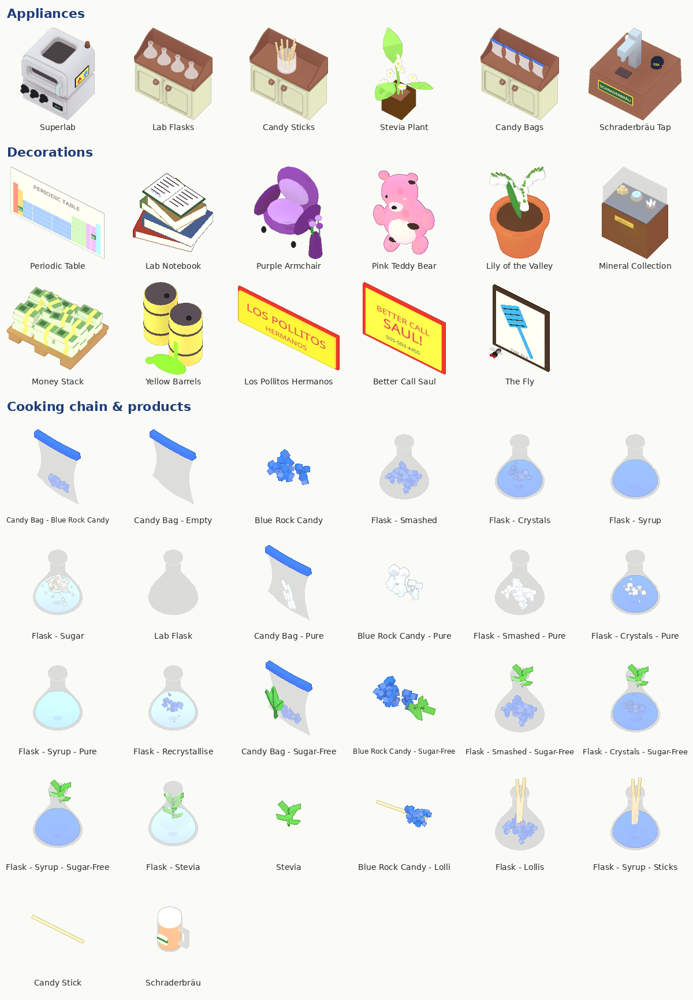

# Breaking Plates

A *Breaking Bad* parody mod for [PlateUp!](https://store.steampowered.com/app/1599600/PlateUp/):
cook **Blue Rock Candy** in lab flasks, smash it up and serve it in little bags. It's just sugar. Probably.

> Status: **v1.0.0** – first release.

**At a glance:** 1 new dish with 4 variants (99.1% pure, Chili P, sugar-free, on a stick), whole-flask orders for groups, 2 sides, an effect card, the **Superlab** (an oven turned lab reactor) and 11 decorations across all four styles. Everything is built from simple shapes in code and checked with an automated self-test.

---

## The dish

| Step | What you do |
|---|---|
| 1 | Take a **lab flask** and add **sugar** and **water** |
| 2 | **Cook** it → blue syrup |
| 3 | Let it **cool down** (12 s, 4 s in a **freezer**, 5 s in the **Superlab**) to get crystals |
| 4 | **Interact** on a counter to smash the crystals → 5 portions |
| 5 | **Portion** it and combine with a **candy bag** to serve |

Every candy bag looks the same: clear foil, blue zip. Toppings and variants are marked on the bag itself.

## Cards

| Card | Type | ★ | Customers | Order pays | What it adds | Quote |
|---|---|---|---|---|---|---|
| **Blue Rock Candy** | Main (base) | 3 | small decrease | 5 | The dish above | *"We need to cook."* |
| **99.1% Purity** | Main | 2 | small decrease | 6 | **Recrystallise**: smashed candy + water back into the flask, cook and cool again → pure (white, `99`). Pure candy also counts for normal orders | *"A higher purity means a greater yield."* |
| **Chili P** | Topping | 1 | small decrease | +1 | Chopped jalapeño in the bag → **chili clipped to the zip** | *"Chili P is my signature!"* |
| **Sugar-Free** | Main | 2 | small decrease | 5 | Cook with **stevia** instead of sugar → bag with a **stevia sprig** | *"I'll need more stevia."* |
| **On a Stick** | Main | 2 | small decrease | 5 | **Candy stick** into the hot syrup → 5 lollis straight from the flask | *"Yeah, science!"* |
| **Mass Production** | Main | 2 | small decrease | 20 | Groups order a **full flask** (up to 5 customers – one per portion) – in every variant you sell. Only a full flask counts. Whoever orders a flask or a lolli orders no side | *"I'm in the empire business."* |
| **Schraderbräu** | Side | 1 | small decrease | 2 | Home-brewed beer from the tap | *"Home-brewed to silky perfection."* |
| **Birthday Bacon** | Side | 2 | small decrease | 2 | Pork from the fridge → chop → fry into bacon (IngredientLib) | *"Fifty-two."* |
| **Breaking Even** | Effect | – | **large decrease** | –25% money | Fewer customers, earn 25% less money | *"Better call Saul!"* |

"Small decrease" / "large decrease" are the game's customer tags (about −15% / −28% customers).
Sides go with every main and can be added to plates and candy bags.
Values are a first pass and still need balancing in real runs.

## Appliances

- **Superlab** – an oven turned lab reactor: cooks everything a little faster than the hob and also cools flasks (5 s) and freezes like a freezer. Lamp and timer show what it's doing.
- **Lab Flasks** (only 4 – think of them as a very scientific pot), **Candy Sticks**, **Stevia** plant, **Candy Bags**, **Schraderbräu** tap.

## Outfit

- **Hazmat Suit** – a yellow full-body suit with a hood, a big dark visor, light blue gloves and a radiation warning sign on the back.

## Decorations

They show up like the game's own decorations, when you pick the matching style.

| Decoration | Style | Points | Price |
|---|---|---|---|
| Periodic Table poster (Br and Ba highlighted) | Formal | 1 | 30 |
| Lab Notebook – "To W.W." | Formal | 1 | 30 |
| Purple Armchair – paid for. Probably. | Formal | 2 | 60 |
| Pink Teddy Bear – why is it so wet? | Charming | 1 | 30 |
| Lily of the Valley – do not eat | Charming | 1 | 30 |
| Mineral Collection – they're minerals, Marie! | Exclusive | 3 | 100 |
| Money Stack – there has to be a better place for this | Exclusive | 2 | 60 |
| Yellow Barrels – why does a kitchen produce so much chemical waste? | Affordable | 2 | 40 |
| Los Pollitos Hermanos sign | Affordable | 1 | 30 |
| Better Call Saul! poster | Affordable | 1 | 30 |
| The Fly (it buzzes) | Affordable | 1 | 30 |

## Colourblind labels

| Label | Meaning |
|---|---|
| `Su` / `SF` / `W` | sugar / stevia (sugar-free) / water in the flask |
| `Sy` | blue syrup (cooked, still hot) |
| `Cr` / `Sh` | crystals / smashed crystals |
| `Re` | flask being recrystallised |
| `99` | pure (99.1%) |
| `SF` | sugar-free |
| `St` | with sticks (lollis) |
| `Ch` | Chili P (chili) |
| `Be` | Schraderbräu (beer) |

## Easter egg

If [Chicken & Rice](https://github.com/TIllAd/ChickenFoodMod) or another chicken mod like *Fry That!* is installed too, their chicken cards show up more often. Los Pollos Hermanos would approve.

---

## Requirements

- [KitchenLib](https://steamcommunity.com/sharedfiles/filedetails/?id=2898069883)
- [IngredientLib](https://steamcommunity.com/sharedfiles/filedetails/?id=2913877103)

## Testing

Use [PlateUp-ModSelfTest](https://github.com/TIllAd/PlateUp-ModSelfTest) with the prefix `TillAd.PlateUp.BreakingPlates`.
It checks every order and ingredient combination with the game's own logic and renders everything the mod adds.

## License

[MIT](LICENSE)

---

*Fan-made parody. Not affiliated with or endorsed by AMC, Sony Pictures Television or the makers of PlateUp!.*
